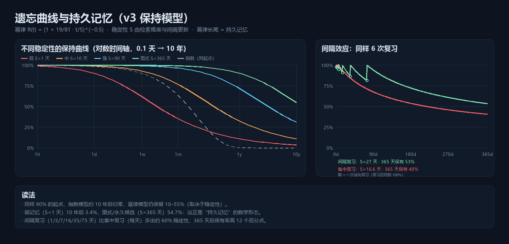
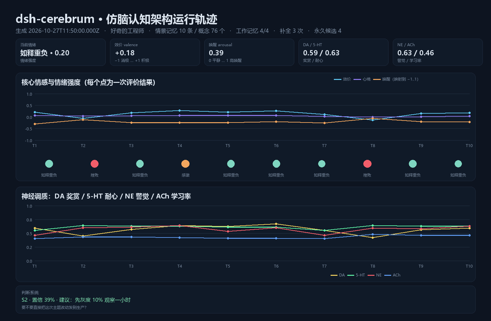

# dsh-cerebrum

**仿脑认知架构插件**：给 DeepSeek Harness 的 Agent 一套连续的记忆、情绪与性格，以及可解释的双过程判断。

> 海马体式情景记忆 · 皮层式语义概念 · 稀疏分布式表征与赫布关联 · **TCM 时序上下文 · CA3 吸引子补全 · 有向 STDP/BCM · 事件分割 · 4 槽工作记忆 · NREM/REM 双阶段巩固 · 幂律遗忘曲线 · 突触标记与持久记忆** · 评价驱动的情绪 · 四种神经调质 · Big Five 性格 · 双过程决策

- 零运行时依赖：纯 ESM，不需要构建，不 import 任何 `@deepseek-ai/*` 包
- 记忆只在本地：一个自我，多套项目记忆（按会话 cwd 分库，情绪与性格全局连续）
- 与提示词缓存友好：静态说明 + 动态 runtime-context，不改写系统提示词前缀

## 它解决什么

| 问题 | 现状 | dsh-cerebrum |
|---|---|---|
| 每次会话都从零开始 | 会话日志无法跨会话复用 | 跨会话情景记忆 + 语义概念 + 幂律遗忘曲线 |
| 记忆"到期就没了" | 指数衰减、一刀切 | 幂律长尾 + 稳定性 S：10 年后仍留 3%–55%，图式记忆进入 permastore |
| "回忆"只是向量 top-k | 没有联想、没有情绪偏置 | 线索→概念扩散→CA3 补全→ACT-R 竞争 + 时序上下文 |
| 每轮都写一条记忆 | 碎片化、重复 | 事件分割：连续工作合并，话题切换/失败才切分 |
| 人格只是提示词里的一句话 | 不参与决策 | Big Five → 探索率/计划深度/冲动抑制/损失厌恶 |
| 情绪只是文案 | 不影响行为 | 效价/唤醒/心境 + DA/5-HT/NE/ACh → 检索偏置、风险偏好、否决 |
| 判断不可解释 | 直接给答案 | 直觉/审议分离，输出期望值、风险、证据与检查清单 |

## 安装

```powershell
# 安装到 desktop profile（重启 DSH 客户端后生效）
dsh plugin --profile desktop add D:\workspace\dsh-cerebrum
```

或手工把本目录链接到 `%USERPROFILE%\.dsh\profiles\desktop\node_modules\dsh-cerebrum`，并把 `dsh-cerebrum` 加入该 profile `package.json` 的 `dsh.profile.bundles`。

首次运行后数据目录：

```
%USERPROFILE%\.dsh\cerebrum\<workspace-slug>\
```

## 工具

| 工具 | 作用 |
|---|---|
| `cerebrum_recall` | 按线索检索长期记忆，返回摘要、时间、情绪色彩、置信度与 `session#seq` 坐标 |
| `cerebrum_remember` | 显式写入一条记忆（用户要求记住、重要结论）；重复自动就地强化 |
| `cerebrum_forget` | 主动遗忘（按 id 或线索），写审计墓碑 |
| `cerebrum_update` | 就地修正一条记忆，不动复习史 |
| `cerebrum_judge` | 双过程决策：直觉 → 期望值/风险/可逆性/规范 → 建议 |
| `cerebrum_appraise` | 对事件做情绪评估，更新效价、心境与神经调质 |
| `cerebrum_consolidate` | 触发"睡眠式"巩固：语义化、强化关联、压缩低价值记忆，留下 sha256 收据 |
| `cerebrum_profile` | 查看/修改 Big Five 与价值观；`scope: global/workspace/session` 三档作用域 |
| `cerebrum_intend` | 前瞻记忆：触发词/截止时间意图，命中即注入提醒 |
| `cerebrum_character` | 角色卡：导入 SillyTavern 卡片（JSON/PNG）→ Big Five 人设，apply 换人格 |
| `cerebrum_pet_asset` | 运行时扩展宠物动作/表情：注册 pet-assets/ 文件或远程 URL，绑定情绪，带权重学习 |
| `cerebrum_pet_visual` | 生成式新表情：按情绪模板调图像模型（默认 mock 离线），入库并参与学习 |
| `cerebrum_state` | 完整状态快照（ASCII 仪表盘：含技能/意向/好感度） |

## GUI（同包内置）

装好插件后，**右键大肥鱼 → 更多 → 🧠 大脑面板** 打开**大脑仪表盘**（默认出现在窗口左侧、可拖动，右上角只有「关闭」）。内容：效价/唤醒/支配条、DA/5-HT/NE/ACh、五因素、记忆/技能/意图/好感。

- **没有输入框芯片了**：面板开关只在宠物右键菜单里；彻底关闭 UI 用配置 `ui.enabled: false`（重启宿主生效）；
- **安全**：回环 API 只接受本机 Host/Origin，不做通配 CORS；可选 `api.token`（同时设置浏览器 `localStorage['cerebrum.token']` 即可让面板带上它）；`/recall` 只读、不训练记忆；`/interact` 限流 30 次/分；
- **宠物联动（免配置）**：检测到同源的 `dsh-pet`（`/dsh-pet-7340`）时，情绪变化会自动推给桌宠——加锁 → 让宠物说一句大脑台词 → 释放锁；不需要用户配置。不想要联动可设 `ui.drivePet: false`；
- **右键菜单**：在 dsh-pet 菜单里注册「cerebrum」分组：大脑面板 / 摸摸头（带动画）/ 喂食（带动画）/ 夸夸（带动画）/ 批评（带动画）/ 播报状态 / 整理记忆（`ui.petMenu` 可关）；
- 数据来自宿主内置的 127.0.0.1 只读 API（`http://127.0.0.1:18734`，端口可配 `config.api.port`）；
- UI 只读：修改记忆/情绪仍通过 `cerebrum_*` 工具；
- 免构建 client bundle（`lib/client.js`），与宿主同一个安装包——**装一个插件，大脑 + 面板都有**。

## 宠物大脑（P3 适配层）

`cerebrum` 不做形象，只做宠物缺的大脑：`lib/core/petbrain.js` 把脑状态翻译成宠物外壳的语言。

```
宠物外壳（dsh-pet / dsh-dafeiyu / live2d）        dsh-cerebrum
        │ 每 5 秒 GET /render-hints              │
        │ ─────────────────────────────────────► │ 情绪 + PAD + 人格
        │ ◄───────────────────────────────────── │   → {expression, animation, line, voicePitch}
        │ 摸头/喂食/夸奖/批评 GET /interact        │
        │ ─────────────────────────────────────► │ 评价 → 情绪 → 表情 → 好感
```

- 15 种情绪 → 表情/动作/台词；四种人格 → 语气（傲娇/元气等映射见 [pet-architecture.md](docs/pet-architecture.md) §3.2）；
- 冷落会自动低落（心境衰减），好感度是情绪史积分（初见→…→挚友）；
- **自主性**：情绪强度 + 沉默时长 + 多巴胺合成 `urgency`，超过阈值且冷却结束就主动演一个动作（`ui.autonomy`）；
- **学习**：动作 120 秒内被互动 → 权重 +0.12，被无视 → −0.08（越用越顺手，冷门动作自然退场）；
- **动态动作/表情**：把 webm/gif 放进 `~/.dsh/cerebrum/pet-assets/`，用 `cerebrum_pet_asset` 绑定情绪即可被自主层择机播放；也支持 http(s) 远程素材；
- **生成式新画面**：`cerebrum_pet_visual` 按情绪模板调模型生成新表情/动作（默认 `mock` 离线；可配 OpenAI/通义万相，或**本地 ComfyUI 出视频**），生成后自动入库、参与权重学习，详见 [pet-autonomy.md §6](docs/pet-autonomy.md)；
- **ComfyUI 自检**：`npm run comfy-check -- --workflow <API格式.json>`；真跑一次加 `--run "提示词"`（约 3 分钟/条，MiniMax H3）；
- 演示：`npm run pet`、`npm run pet-hook`（1 秒轮询真实数据形状）。接入真实宠物（dsh-pet 的 `ctx.pet.announce` / dsh-dafeiyu 的提示词侧）见 [pet-bridge.md](docs/pet-bridge.md)，自主性设计见 [pet-autonomy.md](docs/pet-autonomy.md)；
- 角色卡：`cerebrum_character` 导入 SillyTavern 卡片（JSON 或带 chara 元数据的 PNG），自动映射 Big Five 并就近匹配人格，`first_meshal` 成为声线。

## 配置

`$DSH_HOME/cerebrum/config.json`（优先级高于内置默认，低于行配置）：

```json
{
  "personality": { "preset": "curious-engineer", "drift": 0.001 },
  "memory": { "dim": 2048, "sparsity": 32, "maxEpisodes": 4000 },
  "prompt": { "enabled": true, "recallK": 3, "maxChars": 900 },
  "consolidation": { "everyTurns": 12, "minCluster": 3 }
}
```

人格预设：`curious-engineer` / `stoic-guardian` / `warm-companion` / `restless-artist`。

## 开发

```powershell
npm test          # 90 个单元 + 集成测试（node:test）
npm run check     # 用安装版 DSH 内的真实 Cordis 容器加载插件并跑一轮对话
npm run demo      # 离线仿真，打印情绪/调质时间线并写 examples/.demo/timeline.json
npm run dashboard # 生成 examples/.demo/dashboard.html（自包含可视化）
npm run retention # 计算幂律遗忘曲线与间隔效应，写 examples/.demo/retention.json
```



`npm run check` 依赖 `research/runtime/` 下从安装包提取的 Cordis（见 [research/README.md](research/README.md)）；它验证的是真实容器里的 `ctx.plugin()` 加载、工具注册、`session/event` 投递、prompt 段/上下文注册与落盘。



## 已知限制

- **性能**：检索为纯 JS（SDR + BM25），几万条情景时单次召回仍在毫秒级，但超大库（10 万+）会变慢；
- **GUI 端口**：面板按 18734–18743 探测宿主 API；若把 `api.port` 改到该段之外，面板会显示"未连接"；
- **token 模式**：开启 `api.token` 后，脚本请求必须带 `x-cerebrum-token`；面板需在浏览器 `localStorage['cerebrum.token']` 设置同一个值；
- **多实例并发**：同一工作区被两个 DSH 实例（如 web + desktop）同时写入时没有跨进程锁，内存各持一份、后写者覆盖；建议同一工作区只跑一个实例；
- **无 embedding**：语义检索靠 SDR + 词面，极少数近义改写会走"知道感"（probe）而不是直接召回。

## 文档

- [设计文档（中文）](docs/DESIGN.zh.md) — 脑结构映射、公式、参数、集成方式、评估方案
- [文献与公式笔记](docs/research-notes.md) — 59 条文献、18 组公式
- [v2 机制笔记](docs/research-v2.md) — TCM / BCM / 迹 STDP / 事件分割 / 优先重放 / REM 脱钩
- [v3 遗忘与持久记忆](docs/research-memory-v3.md) — 幂律曲线 / 间隔与测试效应 / 标记捕获 / 干扰 / 知道感
- [开源框架与认知架构调研](docs/oss-survey.md) — Mem0/Letta/Zep/LangMem 与 ACT-R/SOAR/LIDA/HTM/OCC/PAD/BDI 的设计提炼

## 目录

```
lib/
  index.js          插件入口（inject: tools；prompt 可选）
  client.js         GUI client bundle：输入框 dock 芯片 + 大脑仪表盘（免构建）
  api.js            127.0.0.1 只读 JSON API（/ping /state /recall）
  service.js        状态编排、session/event 观测、turn→episode、prompt 渲染
  tools.js          7 个模型工具（纯 JSON Schema，无 dsh-tools 依赖）
  prompt.js         静态 section + 动态 runtime context
  config.js         配置合并与钳制
  core/
    sdr.js          稀疏分布式表征（FNV 地址 + k-WTA + 三元组顺序）
    assembly.js     CA3 吸引子补全（现代 Hopfield）+ LIF 诊断网络
    plasticity.js   TCM / 迹 STDP / BCM / RIF / 重放优先级 / REM 脱钩
    retention.js    幂律遗忘曲线 / 稳定性 S / 标记捕获 / 倒摄干扰 / 知道感
    memory.js       情景/语义/有向关联、ACT-R 激活、扩散、补全、巩固、遗忘、再巩固
    affect.js       评价→情绪→心境→神经调质
    personality.js  Big Five → 决策参数
    judge.js        双过程 + 前景理论 + 冲突监控 + NoGo
    storage.js      原子写、JSONL、去抖写入
    math.js         确定性数值工具
```

## 设计取舍

- **不模拟膜电位**：SDR + k-WTA + 赫布可塑性保留了模式分离、模式补全、联想学习，同时保持可解释与低开销。
- **不依赖 embedding API**：离线可用；同义改写仍能召回，但"零共同词的近义"会漏（见设计文档局限）。
- **情绪不是装饰**：它通过 `salienceGain`、`moodCongruence`、`lossAversion`、`inhibition` 真实改变记忆与判断。
- **失败隔离**：记忆写失败只会打日志，不会让一轮对话失败。

## License

MIT
